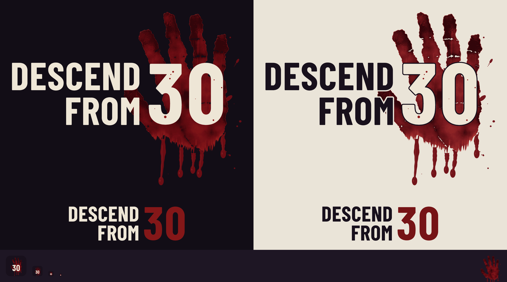

# The logo — "Descend From 30"

Made in-house (owner round 48; the final look in round 48m) by `python3 tools/art/logo.py`:

| piece | file | what it does |
|---|---|---|
| the HAND | `tools/art/logo_photo.py` (+ `logo_src/hand_cut.png`) | the owner's own hand, cut out of their photograph, drawn as a print; the drips |
| the LETTERING's wear | `tools/art/logo_text.py` | the grain, scratches, worn edges and the strikes of blood on the letters; carries the look to any size |
| the layout, outputs, gate | `tools/art/logo.py` | the two faces, the layout, every file below, `--check`, `--press` |

The files below are GENERATED — change the tools, never the files; `tools/art/logo.py --check` (in `tools/run_all_tests.sh`) fails on a stale or missing one.
**It is wired into the TITLE SCREEN** (`scenes/title_screen.tscn`) and the OPENING's title (`scripts/opening_exterior.gd`, round 48n); the run-1 cold-open title card (the black-screen fallback) and `project.godot`'s `icon`
still use the placeholders — see "Using it in the game" below.

## What it is

**The bloodied handprint is the logo** (the owner: "if that doesn't work then the logo doesn't work"), and since round 48m **it is the owner's own hand**: they painted it in
blood paint and photographed it. It sits **directly behind the 30** — the hand's centre of mass on the middle of the numerals (`logo.py --check` holds it within a tenth of the 30's
size), the fingers rising above them, the heel and the drips hanging below. It is a **right hand with the thumb on the LEFT** (owner round 48e), so the thumb reaches toward DESCEND /
FROM and **tucks in UNDER DESCEND** by `TIP_REACH` 0.25 of the 30's height (owner round 48h: "okay with some of the handprint being behind descend a little"). Three drips hang from
the thumb side — two run down BEHIND THE M of FROM — and two from the heel; **no two end alike** (a tapering run, a bead on a neck, a falling droplet, a blunt lip, the original oval:
the owner noticed that identical ovals on every drip read as a stamp).

**The type** (owner round 48m): **DESCEND FROM is Aldrich** (SIL OFL, Matthew Desmond: a squared, slightly technical capital with a strong M) and **the 30 is Barlow Condensed Bold**
(SIL OFL: its round 0 cannot be mistaken for the O of FROM, which Aldrich's squared 0 was). Barlow alone was "a bit like the Last of Us"; the other faces tried (Orbitron, Michroma, Archivo
Black, DM Serif Display, Alfa Slab, a stencil) were each either too wide ("the font spreads things out"), too western, or too far from the game's tone. **Aldrich is set COMPACT** so the
logo keeps Barlow's footprint: squeezed to 0.76 of its width (`WORDS_TARGET` 5.5 = DESCEND's width over cap height; `WORDS_XMIN` 0.64), the vertical stems put back by a sideways dilation
(`WORDS_STEM`, so the strokes do not go spindly — a plain squash does), slightly emboldened (`WORDS_EMBOLDEN`, Aldrich is light beside Barlow) and tracked close (`WORDS_TRACK`).
All of that is measured from the face in `logo.words_params()`, not hand-set. The logo is 1.65 : 1.

**The wear and the blood** (owner: "grimy with a bit of blood is nice"; "the little strikes of blood on the 30"): the lettering is worn like a printed title — FINE grain eaten out in
patches, a few vertical rub-scratches, ragged eroded edges, a faint dirty wash — the SAME on every letter. Over it, strikes of thrown blood (ragged swipes with a head and a broken tail,
spatter, a short run), drawn with a wet uneven edge, a darker pooled rim and three flat tones, **clipped to the letters** (where the letter was worn away the blood is gone too). The 30's
strikes are bigger than the words' (sized to their strokes). A first, chunkier wear "went too far".

**The print is a print, not a photograph** (the owner: "it looks goofy… like a real jpeg under the text"). What is REAL: the silhouette, the pressure (where the blood is thick and thin comes
from the photo's own large-scale shading), the palm's lines and the finger joints (the photo's high-pass detail, in blood tones — black ink lines were "a bit too much"). What is stylised:
no glare or gloss (one lighting glare on the palm was inpainted from the blood round it — it was an accident of the light, not a feature), six posterised blood tones in the game's own
ramp (`logo_print.THIN` .. `THICK`), a pooled darker rim on every edge, cel-shaded drips. Over-smoothing the fingers made them "deep fried… a photocopy of a photocopy", so they keep the
photo's fine detail. `logo_photo.stylise` documents every number.

**The source:** `tools/art/logo_src/hand_cut.png` (1748 x 2000 RGBA) is the photo cut out, made once by steered image work from the owner's 4000 x 3000 photograph turned upright: an AI
segmenter (rembg / isnet) for the outline, a colour rule that keeps only the blood and drops the pale skin fringe, the wrist (cut where the blood ends), the table showing through the finger
gaps and a few lumps of background, and a gentle smoothing of the outline. Nothing is invented — the pixels are the photo's. It is the only input; the photo itself is not in the repository.

## Variants and files (`assets/logo/`, all on transparent backgrounds)

| file | what | for |
|---|---|---|
| `logo_full_dark.png` (2400 px wide) / `_600.png` | the print behind the 30, cream worn letters with their strikes of blood | dark backgrounds — the title screen, a store banner |
| `logo_full_light.png` / `_600.png` | the same with ink words; the 30 stays cream inside an ink keyline so it reads over the blood *and* over the paper; the print is knocked out in a thin halo round the words | light backgrounds — press kit, documents |
| `logo_wordmark_dark|light` (`.svg` pure vector, `.png` 1600 px, `_600.png`) | DESCEND / FROM and the 30 in flat blood, no print, no wear | tight spaces, credits |
| `logo_layer_hand_dark.png` / `logo_layer_text_dark.png` (2400 px wide) | the dark logo as its TWO layers on one canvas — the print, and the worn lettering with its strikes of blood; stacked (hand under text) they are `logo_full_dark.png` exactly | the opening's title: the lettering fades in first, then the hand behind it |
| `mark_handprint.png` (1000 px) | the print alone, drips included | a sticker, a loading mark, a watermark |
| `icon.png` (512), `icon_1024.png`, `icon.ico` (16–256) | the print on a dark rounded tile with the 30 over its palm | app icon, favicon, store tile — reads at 64, the 30 still reads at 32 |

**Advertising renders:** `python3 tools/art/logo.py --press` writes the logo 6000 px wide (transparent + on the dark ground) to `docs/press/` (not in the gate: they are large). They are NOT a new
draw: the look is computed once at 2400 px — the picture the owner approved — and carried up (the letters' edges are re-cut from the vector outlines, the wear / blood maps are resampled and
re-sharpened, the hand is enlarged ~1.5x, its edge re-sharpened), so a press render is the same logo, only sharper. The hand cut-out is the ceiling: ~20 in wide at 300 dpi is its limit; a
bigger print needs a higher-resolution cut-out of the photograph.

**Social platforms crop to their own frames** (the owner's LinkedIn composer showed a square crop that cut off the D and the 0): the logo is 1.65 : 1, so for a feed or a profile post put it on a
square (1:1) or 1.91 : 1 canvas with a dark margin rather than posting the file as it is.

## Colours

Cream `#eee6d6` · night ink `#18101c` · the hand runs from `#b42622` (thin) to `#5c0a10` (thick), strikes of blood `#8e1a1c` / `#621016`; the wordmark's flat 30 is the print's own mid tone
(`#841718`, `#761416` on paper). All are in `tools/art/logo.py` / `logo_print.py` / `logo_text.py`.

## Rules for using it

- Keep the **print directly behind the 30** (the hand's middle on the numerals' middle); do not recolour it brighter, flatten it, or clean up the drips.
- **Clear space**: 10 % of the 30's height on every side (the files already carry it).
- Do not stretch it or re-set the words in another font. The two faces' licences (`assets/fonts/logo/OFL.txt` Barlow, `OFL-Aldrich.txt`) travel with the fonts.
- The studio credit lockup ("Mammoth Games") is not drawn yet.
- The **context rule** (CLAUDE.md "Context") holds: no cause, authority or preparation is named or drawn; the print is a *reaction*, the same bloody handprint the opening's cold open already shows.

## Using it in the game

**Wired (round 48e, owner: "add it without background to our title"; re-laid in round 48g; the final look in round 48m):** `scenes/title_screen.tscn` has `Menu/Logo`, a Sprite2D of
`assets/logo/logo_full_dark.png` (transparent, 2400 x 1452) at scale 0.185 (444 x 269 on the 1152 x 648 screen), centred on (262.6, 188) — the LEFT column, with Play / Settings / Exit
left-aligned under it, DESCEND's first letter on the same line as the buttons' text (x 51; `title_test` measures it from the texture's pixels) — drawn LINEAR + MIPMAPPED (`texture_filter = 4`; the
PNG's import has `mipmaps/generate=true` — the project default is nearest, which would shred a 2400 px image shrunk 5x), above a soft dark shade column (`Menu/Root/LeftShade`) so it reads over the
live hallway behind it (docs/OPENING.md "The title"). `title_test` locks it. **The menu is set in Aldrich** (round 48n; round 48i made it Barlow Condensed to match the 30, the owner then asked for it to match DESCEND FROM): Play / Settings / Exit, 34 px, 2 px glyph spacing, the first letter on the same line as DESCEND's (x 51).

**The opening's title (round 48n, owner: "no background just the text and hand, fade in text first, then fade in the hand behind it"):** `scripts/opening_exterior.gd`'s `Title` is the two layers above (hand behind, a soft shadow made from the lettering's own shape, then the lettering) at 600 px wide over the sky at the top of the climb — see docs/OPENING.md "The opening's title".

Still on the placeholders, and not touched without a word from the owner: `scripts/hallway.gd` / `scripts/intro_overlay.gd` (the run-1 title card, and the black-screen fallback title if the exterior art is ever missing) and `project.godot` (`config/icon="res://icon.svg"` is Godot's default). The suites to re-run after wiring another
place: `title_test`, `opening_test`, `run_bookends_test`, `tutorial_test`.

## The gate (`logo.py --check`)

Every file present and matching what the tools draw (PNGs within a rounding tolerance: mean diff <= 0.6, <= 0.2 % of pixels off by > 24), none extra, the full logos / wordmarks / mark really
transparent, a square icon, both typefaces and their licences present, the hand cut-out present; the composition (the print directly behind the 30, rising above it and hanging below it, >= 55 %
of the numerals over it, DESCEND >= 0.12 and FROM <= 0.30 of the 30's height from the 30, the thumb tucked 0.02 .. 0.30 under DESCEND, the whole logo no wider than 1.75 : 1); the hand in proportion
(width / height 0.60 .. 0.95) and not widening toward its foot; the blood tones not a cartoon red (saturation x value <= 0.60). A run takes about a minute (the hand is drawn once, then the
lettering's look). Needs `pip install fonttools shapely scipy scikit-image pillow numpy` in a fresh container.

## History (what each rejected look taught)

A pixel-art print with a brick-tower 30 — "AI crap"; a flat vector print beside the words — "incorrect"; a flat red print behind the 30 — "some ww2 / cold war spy thriller"; a procedural
print (round 48, rebuilt twice: foam, plastic wrap, then a fine print) — "still very far from good"; an AI edit of the owner's photo — "goofy… needs to be stylised"; a fully stylised cel hand
with black crease lines — "too much… shrivelled like they've been in water too long"; an over-smoothed hand — "deep fried… a photocopy of a photocopy"; a heavily grimed lettering — "went too far";
Barlow Condensed alone — "a bit like the Last of Us"; Orbitron / Michroma / Archivo Black / DM Serif at their natural width — "spreads things out a bit too much"; Aldrich's own 0 — "looks too much like
the O in FROM". The look that stands: the owner's own hand, drawn as a print with its real detail; Aldrich words set compact + Barlow's 30; fine worn lettering with a few strikes of blood.
